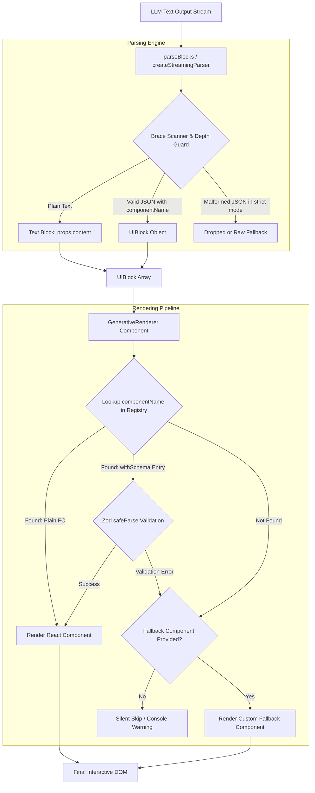
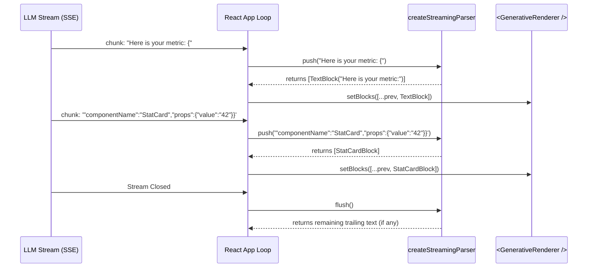

# react-generative-ui

> **The plug-and-play, framework-agnostic React renderer that turns raw LLM text and JSON output into rich, interactive UI components — in real time.**

[](https://www.npmjs.com/package/react-generative-ui)
[](./LICENSE)
[](https://nodejs.org)
[](https://www.typescriptlang.org)
[](https://bundlephobia.com/package/react-generative-ui)

---

## ⚡ Understand in 10 Seconds

When building AI chatbots, agents, or assistants, LLMs (OpenAI, Anthropic Claude, Google Gemini, Ollama) return **unstructured text streams**. Standard chat interfaces render this text as plain markdown paragraphs.

**`react-generative-ui` bridges the gap between text streams and rich React components.**

```
┌─────────────────────────────────────────────────────────────────────────────────────────┐
│ AI Output Stream (Raw Text + Embedded JSON)                                              │
│                                                                                         │
│ "Here is your monthly revenue report:                                                   │
│  {"componentName":"StatCard","props":{"title":"Revenue","value":"$48.2k","trend":"up"}} │
│  Below is the regional breakdown:                                                       │
│  {"componentName":"DataTable","props":{"headers":["Region","Sales"],"rows":[...]}}"    │
└─────────────────────────────────────────────────────────────────────────────────────────┘
                                            │
                                            ▼
                           ┌──────────────────────────────────┐
                           │   react-generative-ui Engine    │
                           │  • parseBlocks()                 │
                           │  • <GenerativeRenderer />        │
                           └──────────────────────────────────┘
                                            │
                                            ▼
┌─────────────────────────────────────────────────────────────────────────────────────────┐
│ Rendered React UI                                                                       │
│                                                                                         │
│ Here is your monthly revenue report:                                                    │
│ ┌──────────────────────────┐                                                            │
│ │ 💰 Revenue    $48.2k 🛈  │  ← Interactive StatCard Component                         │
│ └──────────────────────────┘                                                            │
│ Below is the regional breakdown:                                                        │
│ ┌──────────────────────────┐                                                            │
│ │ Region  │ Sales          │  ← Formatted DataTable Component                           │
│ ├─────────┼────────────────┤                                                            │
│ │ North   │ $21,000        │                                                            │
│ └─────────┴────────────────┘                                                            │
└─────────────────────────────────────────────────────────────────────────────────────────┘
```

### Why Use `react-generative-ui`?

| Challenge with Raw LLM JSON | How `react-generative-ui` Solves It |
|---|---|
| **Manual JSON Extraction** | `parseBlocks()` automatically scans text, extracts JSON blocks with brace-depth protection, and keeps surrounding markdown intact. |
| **Streaming Flakiness** | `createStreamingParser()` handles partial JSON tokens during token-by-token streaming without breaking your layout. |
| **Rigid Chat Framework Lock-in** | Works anywhere in standard React (Next.js, Vite, Remix). No locked-in chat runtimes or proprietary cloud dependencies. |
| **Runtime Crash Risk from Bad LLM Props** | Optional Zod integration validates props at runtime (`withSchema`) and safely falls back without crashing the app. |
| **Style & Design Overhead** | Includes 17 pre-designed components + a CLI (`npx react-generative-ui add`) to copy source code directly into your project (like `shadcn/ui`). |

---

## 📑 Table of Contents

1. [Quick Start](#-quick-start)
2. [Why react-generative-ui?](#-why-react-generative-ui)
3. [Integration Paths](#-three-integration-paths)
4. [Architecture & System Flow](#-architecture--system-flow)
5. [Core Concepts](#-core-concepts)
6. [System Prompting (LLM Setup)](#-system-prompting-llm-setup)
7. [Built-in Component Catalog (17 Components)](#-built-in-component-catalog)
8. [Streaming Support](#-streaming-support)
9. [Zod Schema Validation](#-zod-schema-validation)
10. [CLI Reference](#-cli-reference)
11. [Bundle Size & Subpath Tree-Shaking](#-bundle-size--subpath-tree-shaking)
12. [Security Model](#-security-model)
13. [Comparison Matrix](#-comparison-matrix)
14. [Full API Reference](#-full-api-reference)
15. [TypeScript Reference](#-typescript-reference)
16. [Frequently Asked Questions](#-frequently-asked-questions)
17. [Documentation Directory](#-documentation-directory)
18. [License & Version History](#-license--version-history)

---

## 🚀 Quick Start

Build a working generative UI prototype in under two minutes:

### 1. Install

```bash
npm install react-generative-ui
```

### 2. Define Your Registry & System Prompt

Create `src/generativeUIRegistry.ts`:

```ts
import {
  ComponentRegistry,
  withSchema,
  StatCard, StatCardSchema,
  AlertBox, AlertBoxSchema,
  DataTable, DataTableSchema,
  buildSystemPrompt,
} from 'react-generative-ui';

// 1. Map component names to React components (with optional Zod schemas)
export const registry: ComponentRegistry = {
  StatCard: withSchema(StatCard, StatCardSchema),
  AlertBox: withSchema(AlertBox, AlertBoxSchema),
  DataTable: withSchema(DataTable, DataTableSchema),
};

// 2. Generate a system prompt that teaches the LLM how to format JSON blocks
export const systemPrompt = buildSystemPrompt(registry, {
  StatCard: { title: 'Revenue', value: '$48,200', change: '+12%', trend: 'up' },
  AlertBox: { type: 'warning', title: 'Notice', message: 'Action required' },
  DataTable: { title: 'Sales', headers: ['Region', 'Total'], rows: [{ Region: 'North', Total: '$10k' }] },
});
```

### 3. Parse & Render in Your Chat Component

```tsx
import { useState } from 'react';
import { parseBlocks, GenerativeRenderer, UIBlock } from 'react-generative-ui';
import { registry, systemPrompt } from './generativeUIRegistry';

export default function GenerativeChatApp() {
  const [blocks, setBlocks] = useState<UIBlock[]>([]);

  async function handleSendUserMessage(userQuery: string) {
    const response = await fetch('https://api.openai.com/v1/chat/completions', {
      method: 'POST',
      headers: {
        'Content-Type': 'application/json',
        Authorization: `Bearer ${process.env.NEXT_PUBLIC_OPENAI_KEY}`,
      },
      body: JSON.stringify({
        model: 'gpt-4o',
        messages: [
          { role: 'system', content: systemPrompt },
          { role: 'user', content: userQuery },
        ],
      }),
    });

    const data = await response.json();
    const rawAiText = data.choices[0].message.content;

    // Parse mixed text + JSON blocks
    const parsedBlocks = parseBlocks(rawAiText);
    setBlocks(parsedBlocks);
  }

  return (
    <div className="chat-container">
      <button onClick={() => handleSendUserMessage('Show revenue stats')}>
        Fetch Data
      </button>

      {/* Render plain text paragraphs and dynamic UI components seamlessly */}
      <GenerativeRenderer blocks={blocks} registry={registry} />
    </div>
  );
}
```

---

## 🎯 Why react-generative-ui?

### The Problem

LLMs excel at structured JSON and natural language prose. However, bridging them in frontend code usually requires fragile custom regex, manual component routing, or adopting heavy opinionated chat frameworks that force specific backend architectures.

### The Solution

`react-generative-ui` is built on three core principles:

1. **Framework Independence**: Zero opinion on state management, backend APIs, or chat runtimes. Works with standard React `useState`, TanStack Query, Vercel AI SDK, or WebSocket streams.
2. **Code Ownership (Shadcn-Style CLI)**: Use components directly from NPM or copy the raw React + CSS source code into your project via `npx react-generative-ui add` to customize styling completely.
3. **Fail-Safe Robustness**: Custom brace-depth scanner, input length limits, sanitization against XSS (`javascript:` links blocked), and silent Zod error recovery ensure bad AI output never breaks your UI.

---

## 🛠️ Three Integration Paths

Choose the workflow that fits your team's design and customization requirements:

```
                  ┌─────────────────────────────────────────┐
                  │ How do you want to manage UI components?│
                  └────────────────────┬────────────────────┘
                                       │
         ┌─────────────────────────────┼─────────────────────────────┐
         ▼                             ▼                             ▼
  Path A: Install               Path B: Copy                  Path C: Manual
  (Pure NPM Import)             (Scaffold via CLI)            (Custom Components)
  ─────────────────             ──────────────────            ───────────────────
  • Import from npm             • Scaffolds code into repo    • Use your existing design
  • Fast startup                • Full Tailwind/CSS control     system or UI library
  • Zero setup                  • Modify logic & props        • Pure component mapping
```

| Dimension | Path A: Install | Path B: Copy (Recommended) | Path C: Manual |
|---|---|---|---|
| **Setup Time** | ~1 minute | ~3 minutes | ~5 minutes |
| **Code Ownership** | NPM Node Modules | Your Repository (`/src/components`) | Your Repository |
| **Custom Styling** | CSS overrides | Full TSX + CSS control | Full TSX + CSS control |
| **CLI Usage** | None | `npx react-generative-ui add` | None |
| **Best Used For** | Prototyping & standard dark/light themes | Production apps needing custom brand designs | Integrating internal design systems (MUI, Shadcn, Chakra) |

### Path A: Direct NPM Import

Import components directly from the package root:

```tsx
import { GenerativeRenderer, parseBlocks, withSchema } from 'react-generative-ui';
import { StatCard, StatCardSchema } from 'react-generative-ui';

const registry = {
  StatCard: withSchema(StatCard, StatCardSchema),
};
```

### Path B: CLI Scaffold & Copy (Shadcn Style)

Scaffold a registry file and copy component source files into your project:

```bash
# 1. Initialize starter registry file (src/generative-ui-registry.ts)
npx react-generative-ui init

# 2. Copy component source code directly into src/components/generative-ui/
npx react-generative-ui add stat-card data-table alert-box pro-con-table
```

Edit the generated `.tsx` files inside `src/components/generative-ui/` to match your exact brand guidelines and styling rules.

### Path C: Custom Components

Map any custom React component directly in the registry:

```tsx
const CustomMetricCard: React.FC<{ label: string; amount: number }> = ({ label, amount }) => (
  <div className="p-4 bg-slate-900 rounded-lg text-white">
    <span className="text-sm text-slate-400">{label}</span>
    <h3 className="text-2xl font-bold">${amount.toLocaleString()}</h3>
  </div>
);

const registry = {
  CustomMetricCard,
};
```

---

## 🏗️ Architecture & System Flow

Understanding how `react-generative-ui` transforms raw string streams into rendered component trees:

### Data Flow Diagram



---

## 💡 Core Concepts

### 1. `UIBlock`

The fundamental data structure. Every segment of an AI response is normalized into a `UIBlock`:

```ts
interface UIBlock {
  /** Matches a key string in your ComponentRegistry */
  componentName: string;
  /** Props passed directly into the React component */
  props: Record<string, unknown>;
  /** Unique key for React list rendering (auto-generated if omitted) */
  id?: string;
}
```

- Plain text between JSON segments is converted to `{ componentName: "Text", props: { content: "..." } }`.
- JSON objects with `"componentName"` are converted to `{ componentName: "StatCard", props: { ... } }`.

### 2. `ComponentRegistry`

A key-value dictionary mapping string identifiers to React components or schema-wrapped entries:

```ts
type ComponentRegistry = Record<
  string,
  React.FC<any> | RegistryEntry<any>
>;
```

### 3. `parseBlocks(rawText, options?)`

The parsing function scans raw input text for JSON blocks. It includes:
- **Brace-Depth Protection**: Prevents stack overflow attacks from deeply nested braces (`maxDepth` default: 50).
- **Length Limit Guard**: Protects memory by rejecting inputs larger than `maxInputLength` (default: 1 MB).
- **Strict & Lenient Modes**: `strict: true` (default) drops malformed JSON; `strict: false` renders bad JSON as raw text.

---

## 🤖 System Prompting (LLM Setup)

To ensure your LLM generates correctly formatted JSON blocks alongside markdown prose, use `buildSystemPrompt()` or `getSystemPromptInstruction()`.

```ts
import { buildSystemPrompt } from 'react-generative-ui';

const systemPrompt = buildSystemPrompt(
  registry,
  {
    StatCard: { title: 'Total Revenue', value: '$48,200', change: '+12%', trend: 'up' },
    DataTable: { title: 'Top Products', headers: ['Name', 'Price'], rows: [{ Name: 'Widget', Price: '$99' }] },
  },
  'You are an executive AI assistant. Present clear text explanations accompanied by visual UI cards.'
);
```

### Generated System Prompt Output (Example)

```
You are an executive AI assistant. Present clear text explanations accompanied by visual UI cards.

When you need to display structured data, statistics, comparisons, or visual information,
output a JSON block using the following format EXACTLY (do not wrap in markdown code fences):

{"componentName": "<ComponentName>", "props": { <component specific props> }}

Available components and their formats:
  - StatCard: {"componentName":"StatCard","props":{"title":"Total Revenue","value":"$48,200","change":"+12%","trend":"up"}}
  - DataTable: {"componentName":"DataTable","props":{"title":"Top Products","headers":["Name","Price"],"rows":[{"Name":"Widget","Price":"$99"}]}}

Rules:
1. Only use the component names listed above. Do NOT invent new names.
2. You can mix normal text and JSON blocks in a single response.
3. JSON blocks must be valid JSON — double-quote all keys and string values.
4. If you are unsure which component to use, just respond with normal text.
```

---

## 🎨 Built-in Component Catalog

`react-generative-ui` includes **17 production-ready default templates**.

### Component Overview Table

| Component | Description | Extra Dependencies | Subpath Import |
|---|---|---|---|
| **StatCard** | KPI metric card with trend indicator & emoji icon | None | `react-generative-ui/components/stat-card` |
| **DataTable** | Structured data table with borders & headers | None | `react-generative-ui/components/data-table` |
| **KeyValueList** | Metadata label-value pairs | None | `react-generative-ui/components/key-value-list` |
| **ProConTable** | Two-column pros and cons side-by-side table | None | `react-generative-ui/components/pro-con-table` |
| **ComparisonTable** | Feature grid comparing multiple products | None | `react-generative-ui/components/comparison-table` |
| **BarChart** | Vertical bar chart for quantitative series | `recharts` | `react-generative-ui/components/bar-chart` |
| **LineChart** | Line/area trend chart over time | `recharts` | `react-generative-ui/components/line-chart` |
| **PieChart** | Donut/Pie distribution chart | `recharts` | `react-generative-ui/components/pie-chart` |
| **AlertBox** | Status notice banner (info, success, warning, error) | None | `react-generative-ui/components/alert-box` |
| **Badge** | Inline status tag or category pill | None | `react-generative-ui/components/badge` |
| **ProgressBar** | Linear completion indicator bar | None | `react-generative-ui/components/progress-bar` |
| **Timeline** | Chronological milestone event list | None | `react-generative-ui/components/timeline` |
| **Accordion** | Collapsible FAQ items panel | None | `react-generative-ui/components/accordion` |
| **CodeBlock** | Tokenized syntax highlighted code viewer | None | `react-generative-ui/components/code-block` |
| **SourceList** | Citation list with URL security validation | None | `react-generative-ui/components/source-list` |
| **QuickReplyButtons** | Interactive action prompt pills | None (Needs callback) | `react-generative-ui/components/quick-reply-buttons` |
| **ConfirmationCard** | Action approval/deny decision card | None (Needs callback) | `react-generative-ui/components/confirmation-card` |

---

### Component Specifications & Examples

#### 1. StatCard
*KPI metric display with titles, values, change percentages, trend arrows, and icons.*

```json
{
  "componentName": "StatCard",
  "props": {
    "title": "Monthly Active Users",
    "value": "128,450",
    "change": "+14.2%",
    "trend": "up",
    "icon": "👥"
  }
}
```

#### 2. DataTable
*Tabular grid for structured records.*

```json
{
  "componentName": "DataTable",
  "props": {
    "title": "Top Regional Sales",
    "headers": ["Region", "Rep", "Revenue"],
    "rows": [
      { "Region": "North America", "Rep": "Sarah Jenkins", "Revenue": "$142,000" },
      { "Region": "Europe", "Rep": "Marco Rossi", "Revenue": "$98,500" }
    ]
  }
}
```

#### 3. BarChart (Requires `recharts`)
*Bar visualization for numeric category comparisons.*

```json
{
  "componentName": "BarChart",
  "props": {
    "title": "Quarterly Revenue Growth",
    "data": [
      { "label": "Q1", "value": 45000 },
      { "label": "Q2", "value": 58000 },
      { "label": "Q3", "value": 72000 }
    ],
    "color": "#6366f1"
  }
}
```

#### 4. QuickReplyButtons (Interactive Callback Wrapper Pattern)

Because functions cannot be passed in raw LLM JSON, interactive components (`QuickReplyButtons`, `ConfirmationCard`) use a wrapped component pattern:

```tsx
import { QuickReplyButtons } from 'react-generative-ui';

const ConnectedQuickReplies: React.FC<any> = (props) => (
  <QuickReplyButtons
    {...props}
    onSelect={(optionId: string) => {
      console.log('User clicked option:', optionId);
      // Trigger new chat message or workflow
    }}
  />
);

export const registry = {
  QuickReplyButtons: ConnectedQuickReplies,
};
```

---

## 🌊 Streaming Support

When handling token-by-token HTTP stream responses (Server-Sent Events), use `createStreamingParser()` to buffer partial tokens and render completed blocks in real time.

### Streaming Lifecycle Diagram



### Complete Streaming Example

```tsx
import { useState } from 'react';
import { createStreamingParser, GenerativeRenderer, UIBlock } from 'react-generative-ui';
import { registry, systemPrompt } from './generativeUIRegistry';

export default function StreamingChat() {
  const [blocks, setBlocks] = useState<UIBlock[]>([]);

  async function startStreamingChat(prompt: string) {
    const parser = createStreamingParser({ strict: true });
    setBlocks([]);

    const response = await fetch('/api/chat-stream', {
      method: 'POST',
      body: JSON.stringify({ prompt, systemPrompt }),
    });

    const reader = response.body!.getReader();
    const decoder = new TextDecoder();

    while (true) {
      const { done, value } = await reader.read();
      if (done) break;

      const chunk = decoder.decode(value, { stream: true });
      const newParsedBlocks = parser.push(chunk);

      if (newParsedBlocks.length > 0) {
        setBlocks((prev) => [...prev, ...newParsedBlocks]);
      }
    }

    // Flush any remaining buffer when stream finishes
    const trailingBlocks = parser.flush();
    if (trailingBlocks.length > 0) {
      setBlocks((prev) => [...prev, ...trailingBlocks]);
    }
  }

  return (
    <div>
      <button onClick={() => startStreamingChat('Generate summary report')}>
        Start Stream
      </button>
      <GenerativeRenderer blocks={blocks} registry={registry} />
    </div>
  );
}
```

---

## 🛡️ Zod Schema Validation

Validate LLM props at runtime before rendering to ensure bad types (e.g. string passed instead of number array) don't throw React rendering errors.

```tsx
import { z } from 'zod';
import { withSchema, GenerativeRenderer } from 'react-generative-ui';

// 1. Define component prop schema
export const CustomChartSchema = z.object({
  title: z.string(),
  values: z.array(z.number()),
  theme: z.enum(['dark', 'light']).default('dark'),
});

type CustomChartProps = z.infer<typeof CustomChartSchema>;

const CustomChart: React.FC<CustomChartProps> = ({ title, values, theme }) => (
  <div className={`chart-${theme}`}>
    <h4>{title}</h4>
    <p>Points: {values.join(', ')}</p>
  </div>
);

// 2. Register with withSchema() helper
export const registry = {
  CustomChart: withSchema(CustomChart, CustomChartSchema),
};
```

### Fallback Lifecycle on Validation Error

```
LLM sends bad props ──► schema.safeParse(props) ──► success: false
                                                         │
               ┌─────────────────────────────────────────┴────────────────────────┐
               ▼                                                                  ▼
   debug: true (Development)                                        Custom Fallback Provided?
   Logs warning with Zod issue details                               ├─► Yes: Renders <Fallback block={block} />
                                                                     └─► No:  Silently skips block
```

---

## 💻 CLI Reference

The CLI powers **Path B (Copy)** workflow, copying component source code directly into your repository.

```bash
npx react-generative-ui <command> [options]
```

### Commands

#### 1. `init`
Scaffolds a starter `src/generative-ui-registry.ts` file configured with 4 default components and ready-to-use system prompt generation.

```bash
npx react-generative-ui init
```

#### 2. `add <component-name...>`
Copies the `.tsx` component file and `.schema.ts` file into your local project directory.

```bash
# Add a single component
npx react-generative-ui add stat-card

# Add multiple components
npx react-generative-ui add stat-card alert-box data-table pro-con-table

# Add all 17 default components
npx react-generative-ui add --all
```

#### 3. `list`
Lists all 17 available default components with descriptions and dependency notes.

```bash
npx react-generative-ui list
```

### CLI Flags

| Flag | Description | Default |
|---|---|---|
| `--dir <path>` | Directory path where components will be written | `./src/components/generative-ui/` |
| `--overwrite` / `-y` / `--yes` | Skip overwrite prompt confirmations (ideal for CI / agents) | `false` |
| `--all` | Scaffold all available components at once | `false` |

---

## 📦 Bundle Size & Subpath Tree-Shaking

`react-generative-ui` supports granular subpath imports to keep your production bundle lean.

### 1. Root Import (Convenient)

```tsx
import { StatCard, AlertBox } from 'react-generative-ui';
```

Includes main package engine + schema definitions. Components tree-shake, but schemas are included.

### 2. Subpath Import (Maximum Tree-Shaking Efficiency)

```tsx
// Only StatCard source + schema is included in bundle
import { StatCard, StatCardSchema } from 'react-generative-ui/components/stat-card';
import { AlertBox, AlertBoxSchema } from 'react-generative-ui/components/alert-box';
import { withSchema } from 'react-generative-ui';
```

---

## 🔒 Security Model

Handling un-sanitized content generated by external AI models presents unique security considerations:

| Risk Vector | Built-in Protection Mechanism |
|---|---|
| **XSS via Malicious Links** | `SourceList` automatically checks all URLs and blocks non-web protocols (`javascript:`, `data:`, `vbscript:`). Only `http:` and `https:` are permitted. |
| **HTML Injection** | Zero usage of `dangerouslySetInnerHTML`. `CodeBlock` uses a tokenized syntax highlighter that escapes raw strings into safe React elements. |
| **Nested Brace ReDoS / Stack Overflow** | `scanJSONObjects` enforces a `maxDepth` limit (default 50) when scanning braces. |
| **Buffer Memory Exhaustion** | Input strings and streaming buffers are capped at `maxInputLength` (default 1 MB). |

---

## ⚖️ Comparison Matrix

How `react-generative-ui` compares against alternative architectural choices:

| Feature / Metric | Manual JSON Parsing | `@assistant-ui/react-generative-ui` | `react-generative-ui` |
|---|---|---|---|
| **Architecture** | Custom regex / ad-hoc | Tightly coupled to `assistant-ui` runtime | 100% Framework & Runtime Agnostic |
| **Component Customization** | Built from scratch | Theme overrides | NPM import OR Copy TSX source via CLI |
| **Streaming Parser** | Hand-rolled buffer logic | Internal framework store | Built-in `createStreamingParser` |
| **LLM Vendor Support** | Any | Any (via assistant-ui) | Any (OpenAI, Anthropic, Gemini, Ollama, Custom API) |
| **Runtime Validation** | Manual | Schema dependent | Built-in Zod support via `withSchema` |
| **Security Guards** | Needs manual checks | Internal | Built-in URL sanitizer, depth guards, zero `dangerouslySetInnerHTML` |
| **Dependencies** | Custom | `assistant-ui` stack | React (zero required external runtime deps) |

---

## 📖 Full API Reference

### `parseBlocks(rawText: string, options?: ParseOptions): UIBlock[]`
Scans `rawText` for JSON blocks containing `"componentName"`. Surrounding text is converted to `Text` blocks.

### `parseBlocksFromJSON(jsonString: string): UIBlock[]`
Parses pure JSON array strings or `{ blocks: [...] }` objects into `UIBlock[]`.

### `createStreamingParser(options?: ParseOptions)`
Returns `{ push(chunk: string): UIBlock[], flush(): UIBlock[] }` for handling token streams.

### `buildSystemPrompt(registry, schemas?, baseInstruction?): string`
Generates a complete system prompt string instructing the LLM on available components and formatting rules.

### `getSystemPromptInstruction(registry, schemas?): string`
Generates only the instruction snippet portion of the system prompt.

### `withSchema(component, schema): RegistryEntry`
Pairs a React component with a Zod schema for registration.

### `<GenerativeRenderer blocks={blocks} registry={registry} fallback={Fallback} debug={boolean} className={string} />`
The primary React renderer component.

---

## 🔷 TypeScript Reference

```ts
import type {
  UIBlock,
  ComponentRegistry,
  RegistryEntry,
  GenerativeRendererProps,
  ParseOptions,
} from 'react-generative-ui';
```

---

## ❓ Frequently Asked Questions

#### Q: Is `react-generative-ui` locked to OpenAI?
**No.** It works with any LLM provider (Anthropic Claude, Google Gemini, Ollama, HuggingFace, Groq, or custom local models) as long as the LLM receives the system prompt instruction.

#### Q: Does `react-generative-ui` work with Next.js App Router?
**Yes.** All components are fully compatible with Next.js (Client Components where interactivity is needed).

#### Q: Do I have to use Zod?
**No.** Zod is optional. If omitted, props passed by the LLM are given directly to your React component.

#### Q: Do I need Recharts?
Only if you use `BarChart`, `LineChart`, or `PieChart`. The other 14 components have zero extra dependencies.

---

## 📂 Documentation Directory

For dedicated topic guides, inspect the `/docs` directory:

- [Getting Started Guide](./docs/getting-started.md)
- [Architecture & Deep Dive](./docs/architecture.md)
- [17 Component Catalog Reference](./docs/components.md)
- [Streaming Guide](./docs/streaming.md)
- [Security Model](./docs/security.md)
- [API Reference Manual](./docs/api.md)
- [CLI Reference](./docs/cli.md)
- [Frequently Asked Questions](./docs/faq.md)

---

## 📜 License & Version History

MIT License © Hema Surya

See [CHANGELOG.md](./CHANGELOG.md) for version release history.
