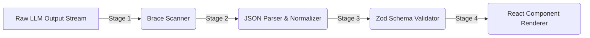
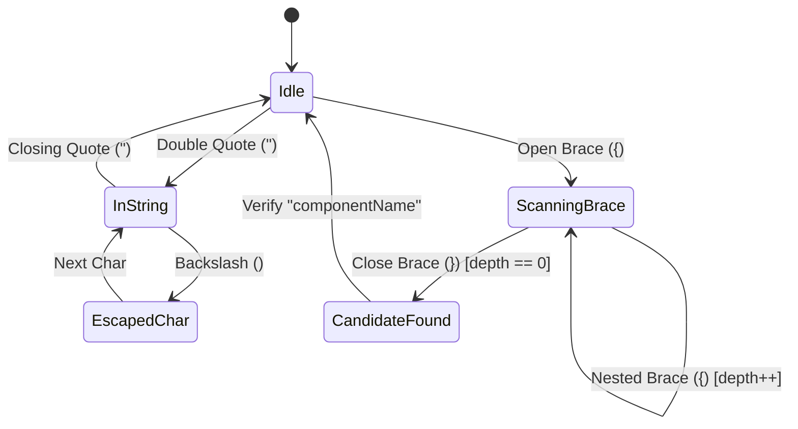

# Architecture & System Design — react-generative-ui

This document provides a technical deep dive into the inner workings of `react-generative-ui`, explaining the parsing pipeline, streaming buffer engine, component registry resolution, and security safeguards.

---

## 1. System Pipeline Overview

`react-generative-ui` transforms unstructured LLM outputs into structured React components through a four-stage pipeline:



---

## 2. Parsing Engine (`src/parser.ts`)

### `scanJSONObjects(text, maxDepth)` Scanner

The parsing engine uses a stateful character-by-character scanner rather than simplistic regex to locate JSON blocks embedded inside natural language prose.

#### Scanner Rules:
1. **String Literal Tracking**: Tracks single/double quote boundaries and backslash escapes (`\"`, `\\`) to ensure JSON braces inside string values (e.g., `"content": "Check {this} brace"`) do not distort nesting counts.
2. **Depth Counter (`braceDepth`)**: Increments on `{` and decrements on `}` outside strings.
3. **Max Depth Guard (`maxDepth: 50`)**: Throws an error if nesting exceeds maximum limits, mitigating potential ReDoS / stack overflow vulnerabilities.
4. **Fast Pre-check**: Candidate JSON blocks are verified with `/"componentName"\s*:/` before calling `JSON.parse()`.



---

## 3. Streaming Engine (`createStreamingParser`)

During SSE token streaming, partial JSON payloads arrive in chunks. The streaming engine maintains an internal buffer string and yields blocks incrementally.

```mermaid
flowchart TD
    A[Incoming Chunk] --> B[Append to Buffer String]
    B --> C[scanJSONObjects on Buffer]
    C --> D{Candidate JSON Found?}
    D -->|Yes| E[Extract Text Before Candidate -> Text Block]
    E --> F[JSON.parse Candidate -> Component UIBlock]
    F --> G[Slice Candidate from Buffer]
    G --> C
    D -->|No| H[Retain Remaining Partial String in Buffer]
    H --> I[Return Newly Completed UIBlock[]]
```

### Flush Phase
When the LLM finishes streaming, `flush()` drains any residual plain text remaining in the buffer and converts it into a final `Text` block.

---

## 4. Component Resolution & Rendering (`src/GenerativeRenderer.tsx`)

The `<GenerativeRenderer />` component iterates over `UIBlock[]` array and matches `block.componentName` against the `ComponentRegistry`.

```mermaid
flowchart TD
    A[Iterate UIBlock in blocks array] --> B{Lookup block.componentName in registry}
    B -->|Found| C{Is Entry wrapped with Schema?}
    B -->|Not Found| D{Fallback Component Provided?}
    
    C -->|No: Plain FC| E[Render <Component {...props} />]
    C -->|Yes: withSchema| F[Run schema.safeParse(props)]
    
    F -->|Success| G[Render <Component {...result.data} />]
    F -->|Failure| H{Fallback Component Provided?}
    
    D -->|Yes| I[Render <Fallback block={block} />]
    D -->|No| J[Log warning in dev & return null]
    
    H -->|Yes| I
    H -->|No| J
```

---

## 5. Built-in `Text` Component Override

By default, plain text blocks render as standard paragraph elements `<p style={{ margin: '0.5rem 0', lineHeight: 1.6 }}>`.

You can override this globally by adding a `"Text"` key to your `ComponentRegistry`:

```tsx
const customRegistry: ComponentRegistry = {
  Text: ({ content }: { content: string }) => (
    <div className="prose dark:prose-invert my-2">{content}</div>
  ),
  StatCard: withSchema(StatCard, StatCardSchema),
};
```
